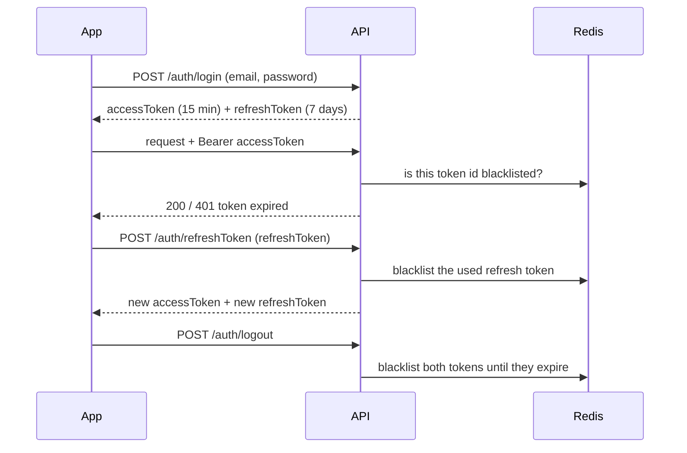
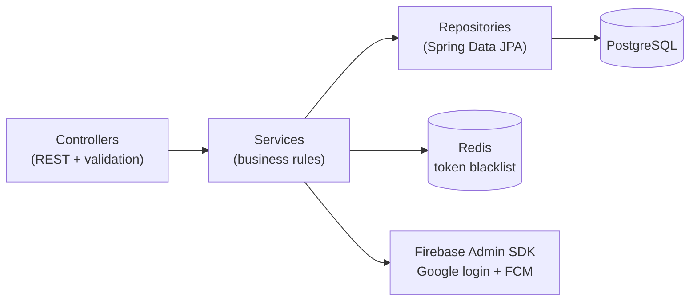
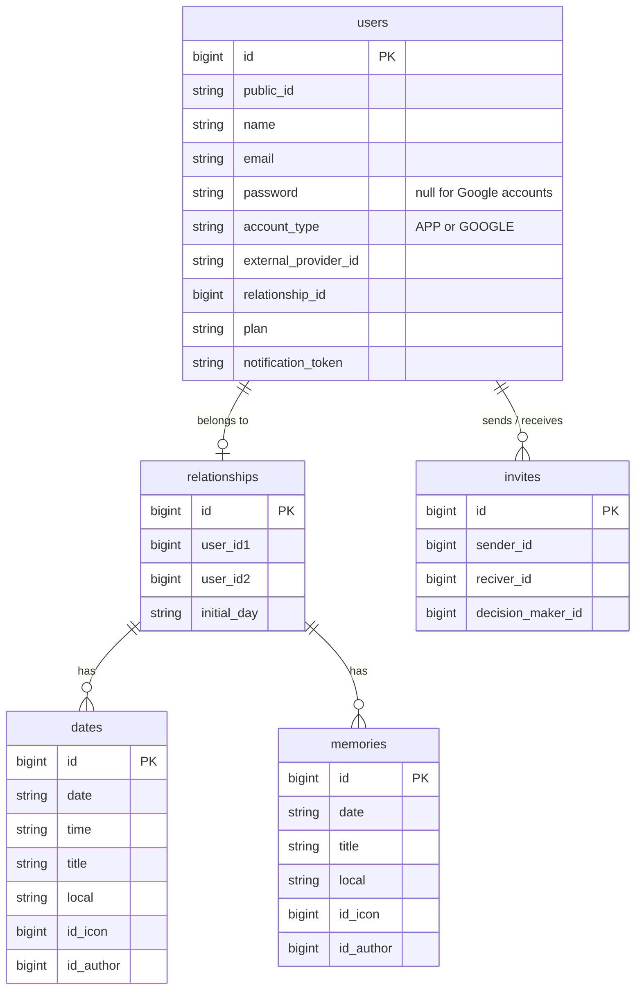

<p align="center">
  
</p>

<h1 align="center">DatePlan API</h1>

<p align="center">
  <b>REST backend of DatePlan, the app for couples.</b><br>
  Spring Boot 4 · Java 21 · PostgreSQL · Redis · Firebase
</p>

<p align="center">
  <a href="https://github.com/DatePlanApplication/DatePlan-API/actions/workflows/cd.yml"></a>
  
  
  
  
  <a href="./LICENSE"></a>
</p>

<p align="center">
  <a href="https://github.com/DatePlanApplication/DatePlan">Mobile app</a> ·
  <a href="https://play.google.com/store/apps/details?id=mayckgomes.com.dateplan">Google Play</a> ·
  <a href="https://dateplanapp.netlify.app">Website</a> ·
  <a href="./README.pt-BR.md">Português</a>
</p>

---

This is the backend of [DatePlan](https://github.com/DatePlanApplication), where a couple plans dates, keeps
shared memories and counts the days together. It lets two accounts link through an **invite**, then share a
calendar of **dates**, **memories** and the relationship start day, and it pushes changes to the partner's phone
with Firebase Cloud Messaging.

It runs in production on a small Oracle Cloud VM (1 GB of RAM), so the defaults favor a small memory footprint.

## Contents

[Features](#features) · [API overview](#api-overview) · [Authentication](#authentication) ·
[Architecture](#architecture) · [Data model](#data-model) · [Tech stack](#tech-stack) ·
[Getting started](#getting-started) · [Configuration](#configuration) · [Docker](#docker) ·
[Deployment](#deployment) · [Testing](#testing) · [Roadmap](#roadmap-and-known-limitations) ·
[Contributing](#contributing) · [License](#license)

## Features

- **Accounts:** register and log in with email and password, or with **Google** (ID token verified through the Firebase Admin SDK).
- **Sessions:** short-lived access tokens, long-lived refresh tokens with **rotation**, logout with a **Redis blacklist**.
- **Relationships:** link two users through invites (send, accept, decline), set the start day, end the relationship.
- **Dates:** create, edit, list and delete planned dates; the partner is notified on every change.
- **Memories:** create, edit and delete memories, or **convert a past date into a memory**.
- **Push notifications:** data messages sent through Firebase Cloud Messaging.
- **Legal consent:** stores which version of the privacy policy and terms of use each user accepted, and when.

## API overview

Detailed request and response bodies are in [`docs/`](./docs). Routes marked 🔒 need
`Authorization: Bearer <accessToken>`.

| Module | Routes | Docs |
|---|---|---|
| **Server** | `GET /` → `204` (health check used by the app) | [server](docs/server/server.MD) |
| **Auth** | `POST /auth/register` · `/auth/login` · `/auth/google` · `/auth/autoLogin` · `/auth/refreshToken` · 🔒 `/auth/logout` | [auth](docs/auth/auth.MD) |
| **Users** 🔒 | `PATCH /users/changeName` · `/users/changePassword` · `/users/updateNotificationToken` · `/users/updatePolicyPrivacy` · `/users/updateTermsOfUse` · `DELETE /users/` | [users](docs/users/users.MD) |
| **Relationship** 🔒 | `GET /relationship/` · `PATCH /relationship/initialDay` · `DELETE /relationship/` | [relationship](docs/relationship/relationship.MD) |
| **Invites** 🔒 | `POST /invites/create` · `GET /invites/toMe` · `POST /invites/accept` · `POST /invites/decline` | [invite](docs/invite/invite.MD) |
| **Dates** 🔒 | `POST /dates/create` · `PUT /dates/edit` · `DELETE /dates/delete` · `POST /dates/{id}/convert-to-memory` | [date](docs/date/date.MD) |
| **Memories** 🔒 | `POST /memories/create` · `PUT /memories/edit` · `DELETE /memories/delete` | [memories](docs/memories/memories.MD) |

Errors use one JSON shape: `{ "status": 404, "message": "..." }`. Validation errors list the invalid fields.

## Authentication



- Tokens are **JWT** signed with HMAC-SHA256 (`java-jwt`), with `iss`, `aud`, a unique `jti` and a `type` claim
  (`Access` or `Refresh`) that is checked on every verification.
- Each refresh token can be used **once**: its `jti` goes to the Redis blacklist and a new pair is issued.
- Passwords are hashed with **Argon2id** (Spring Security's `Argon2PasswordEncoder`); salt length, hash length,
  parallelism, memory and iterations come from the environment.
- The security filter (`SecurityFilter`) runs before Spring's authentication filter, rejects expired, invalid or
  blacklisted tokens with `401` and loads the user on every request. The API is stateless (no sessions, no cookies).

## Architecture

Classic layered Spring architecture:



```text
src/main/java/com/mayckgomes/dateplan_api/
├── controllers/     REST endpoints
├── services/        business rules (Auth, User, Relationship, Invite, Date, Memory, RedisBlackList)
├── repositorys/     Spring Data JPA interfaces
├── entitys/         JPA entities
├── dto/             request and response objects, one package per module
├── jwt/             token creation and verification
├── configurations/  security chain, security filter, Firebase
├── exception/       custom domain exceptions and @ControllerAdvice handlers
├── domains/         domain objects
└── utils/           push notifications, public id generation, token text helper
```

Design notes:

- Domain failures are custom exceptions (`exception/custom/*`) translated to HTTP responses by handlers in `exception/handler`.
- Every user gets a **public id** (derived from name and email) so partners can find each other without exposing numeric ids.
- Schema changes are versioned with **Flyway**; Hibernate only validates (`ddl-auto=validate`).
- The Hikari pool is tuned for small instances (`maximum-pool-size=3`, `minimum-idle=0`).

## Data model



The migrations are in [`src/main/resources/db/migration`](./src/main/resources/db/migration) (`V1` to `V5`).

## Tech stack

| Area | Technology |
|---|---|
| Language | Java 21 |
| Framework | Spring Boot 4.0 (Web MVC, Security, Validation, Data JPA, Data Redis, Flyway) |
| Database | PostgreSQL · H2 on the classpath for tests and tooling |
| Cache and blacklist | Redis |
| Tokens | `com.auth0:java-jwt` 4.5 |
| Passwords | Argon2id (Spring Security; BouncyCastle on the classpath) |
| Push and Google login | Firebase Admin SDK 9.8 |
| Config | `spring-dotenv` (loads a local `.env`) |
| Build | Gradle · Docker multi-stage |
| CI/CD | GitHub Actions → SSH deploy |

## Getting started

### Prerequisites

- JDK 21
- PostgreSQL and Redis (the compose file below starts both)
- A Firebase project with a **service account** JSON (used for Google login and push notifications)

### 1. Start PostgreSQL and Redis

Create a `docker-compose.yml` next to the project (not included in the repo), for local development only:

```yaml
services:
  postgres:
    image: postgres:17
    environment:
      POSTGRES_DB: dateplan
      POSTGRES_USER: dateplan
      POSTGRES_PASSWORD: dateplan
    ports: ["5432:5432"]
  redis:
    image: redis:7
    ports: ["6379:6379"]
```

```bash
docker compose up -d
```

### 2. Configure

```bash
cp .env.example .env
```

Edit `.env` (see [Configuration](#configuration)). For the compose file above:

```properties
DB_URL=jdbc:postgresql://localhost:5432/dateplan
DB_USERNAME=dateplan
DB_PASSWORD=dateplan
REDIS_URL=redis://localhost:6379
```

### 3. Run

```bash
./gradlew bootRun
```

The API listens on `http://localhost:8080`. Flyway creates the schema on the first start.
Check it with `curl -i http://localhost:8080/`, which should answer `204 No Content`.

To point the [mobile app](https://github.com/DatePlanApplication/DatePlan) at it, set `API_BASE_URL`
(the Android emulator reaches your computer as `http://10.0.2.2:8080`).

## Configuration

Values come from environment variables or from a `.env` file in the working directory (ignored by git).

| Variable | Description |
|---|---|
| `SECRET` | HMAC secret that signs the JWTs. Use a long random value (at least 32 bytes) |
| `ISSUER` / `AUDIENCE` | `iss` and `aud` claims of the JWTs |
| `SALT_LENGTH` · `HASH_LENGTH` · `PARALLELISM` · `MEMORY` · `ITERATIONS` | Argon2id parameters. Spring's defaults are `16`, `32`, `1`, `16384` (KB) and `2` |
| `REDIS_URL` | Redis connection URL, for example `redis://localhost:6379` |
| `FIREBASE_JSON_PATH` | Path of the service account JSON as a Spring resource, for example `file:/secure/path/firebase.json` |
| `DB_URL` / `DB_USERNAME` / `DB_PASSWORD` | PostgreSQL JDBC URL and credentials |
| `PORT` | Optional. HTTP port (default `8080`) |

> ⚠️ **Never commit** `.env` or the Firebase service account JSON. Anyone with that JSON can act as your Firebase
> project. Keep it outside the repository and rotate it if it ever leaks.

Without a valid Firebase JSON the API still starts, but Google login and push notifications will fail.

## Docker

The multi-stage [`Dockerfile`](./Dockerfile) builds with Gradle and runs on `eclipse-temurin:21-jre` with JVM flags
tuned for a small instance (heap up to 736 MB, ZGC, exit on out-of-memory):

```bash
docker build -t dateplan-api .
docker run --env-file .env -p 8080:8080 dateplan-api
```

## Deployment

[`cd.yml`](./.github/workflows/cd.yml) runs on every push to `master`: it builds the JAR, copies it to the server
over SCP and restarts the `systemd` service over SSH. It needs three repository secrets: `HOST`, `USERNAME` and `SSHKEY`.

In production the service sits behind **NGINX** (TLS and rate limiting), which are configured on the server and
are not part of this repository.

## Testing

There is a single smoke test (`contextLoads`), which needs a reachable PostgreSQL, Redis and the variables above.

```bash
./gradlew test
```

Unit and integration tests for the services are a priority; see the roadmap.

## Roadmap and known limitations

- [ ] Automated tests for the services and for the authentication flow
- [ ] A `docker-compose.yml` for local development in the repository
- [ ] OpenAPI / Swagger documentation generated from the controllers
- [ ] Rate limiting inside the application (today it is done by NGINX)
- [ ] Remove the H2 console route from the security configuration and the H2 console dependency
- [ ] Use the logger instead of `System.out` for Firebase and notification errors

## Contributing

Contributions are welcome. Read [CONTRIBUTING.md](./CONTRIBUTING.md) and follow the
[Code of Conduct](./CODE_OF_CONDUCT.md). For vulnerabilities, do **not** open a public issue: see [SECURITY.md](./SECURITY.md).

## License

Source code is **source-available** under the [PolyForm Noncommercial License 1.0.0](./LICENSE):
you can read, study, modify and use it for **noncommercial** purposes. Commercial use requires written permission
from the author. The name "DatePlan", the logo and the app icons are not covered by the license.

Created by [Mayck Gomes](https://github.com/MayckGomes).
